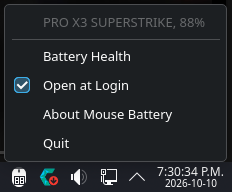
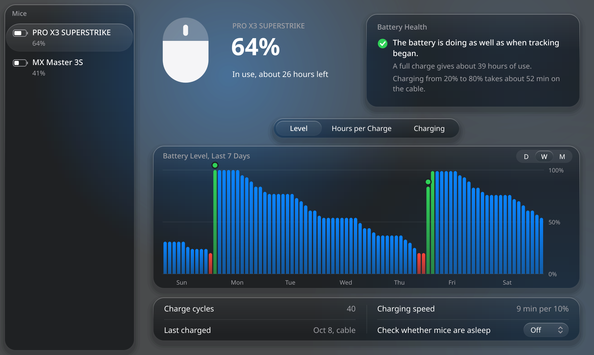
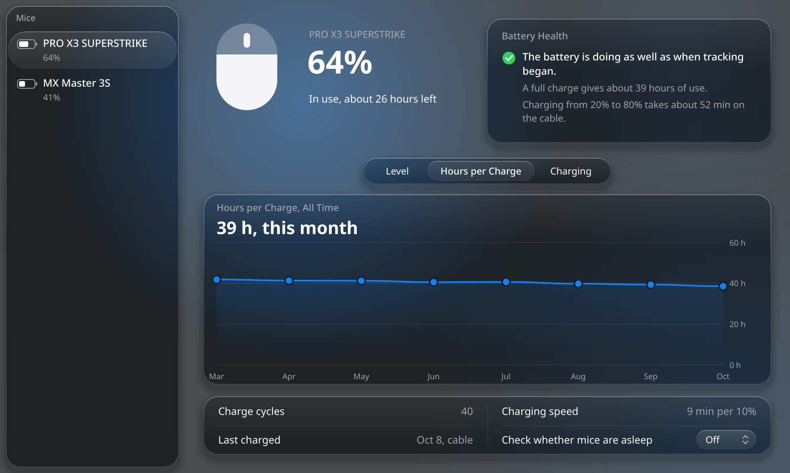

# Mouse Battery

Mouse Battery shows the battery level of your Logitech mouse in the system tray on Linux, with a battery window that tracks how the battery holds up over time. It warns you at 10% and again at 5%, and when you have more than one mouse, it follows the one you're using.



Mouse Battery isn't affiliated with Logitech.

## Install

On Ubuntu and Debian, download the `.deb` from the [latest release](https://github.com/kymotsujason/logitech-mouse-battery-tray-icon/releases/latest) and double click it, or install it from a terminal:

```bash
sudo apt install ./logitech-mouse-battery_1.2.3_all.deb
```

On Fedora, download the `.rpm` from the same page:

```bash
sudo dnf install ./logitech-mouse-battery-1.2.3-1.noarch.rpm
```

On Arch, download the `.pkg.tar.zst` from the same page and install it with pacman:

```bash
sudo pacman -U ./logitech-mouse-battery-1.2.3-1-any.pkg.tar.zst
```

An AUR package will follow once the AUR opens account registrations again.

The package gives Mouse Battery's service access to your receiver or cable, including one that's already plugged in, so there's no need to replug anything.

Each file in a release after 1.1.0 comes with a signed record of how it was built. To check a download with the GitHub CLI before you install it:

```bash
gh attestation verify ./logitech-mouse-battery-1.2.3-1-any.pkg.tar.zst --repo kymotsujason/logitech-mouse-battery-tray-icon
```

## Use

Installing doesn't start Mouse Battery, so open "Mouse Battery" from your app menu once. After that it starts by itself at login, for every account on the computer, until that account turns off "Open at Login" in the menu.

The icon is a mouse that fills up with the battery level and shows the percentage when the tray is large enough. The fill turns green while the mouse is on its charger, red at 20% or below, and gray while the mouse sleeps. The menu lists every mouse it found, for example:

- `PRO X3 SUPERSTRIKE, 69%`
- `PRO X3 SUPERSTRIKE, charging, 82%`
- `PRO X3 SUPERSTRIKE, asleep, 69% at 21:40`

Opening the menu refreshes the reading of each mouse the battery service reads itself, while a mouse read through UPower follows UPower's own updates. A mouse that's asleep shows its last reading and when it was taken. A mouse that reports its own battery, as the PRO X3 SUPERSTRIKE does, isn't read on a timer. So its icon stays in color while it sleeps, unless you turn on "Check whether mice are asleep" in the battery window.

## Battery window

Click the tray icon, or pick "Battery Health" from its menu, to open the battery window. It shows the mouse's level and status, a health box, and a level chart for the last 24 hours, 7 days, or 30 days. It also shows how many hours a charge lasts and how fast it charges month by month, and when the mouse was last charged. With two or more mice, a sidebar lists them all. The window draws its own title bar, so you move it by dragging any empty space and maximize it with a double click.





The health box compares how the battery drains and charges now with how it did when tracking began, and warns when a charge lasts 15% less or charging takes 15% longer. That takes about 42 charges, so until then it says it's still learning. Once it has measured enough, it also says how many hours a full charge gives and how long charging from 20% to 80% takes. Some mice report too little for these figures, and the box says so when that happens.

"Check whether mice are asleep" reads the mice the battery service reads itself every 30 seconds, every minute, or every 5 minutes, so the icon turns gray soon after one sleeps. A mouse read through UPower updates on its own and shows as asleep when its link drops. The check is off unless you turn it on.

The battery service saves the history in `/var/lib/logitech-mouse-battery/history.sqlite3`, about 20 MB after 10 years of heavy use. Any account on the computer can read it, as it can read the battery levels, and it shows when each mouse was in use. A mouse that doesn't give a serial number gets no history.

## Which mice work

Mice the Linux kernel already drives, such as most Unifying, LIGHTSPEED, and Bluetooth mice, are read through UPower. Mice on a receiver or cable the kernel leaves alone are read over Logitech's HID++ protocol by Mouse Battery's service. That covers the PRO X3 SUPERSTRIKE's receiver (`046d:c54f`) and USB cable (`046d:c0a9`), and on kernels that don't drive them, receivers such as the LIGHTSPEED `046d:c547` and the Logi Bolt `046d:c548`.

It has been tested with the PRO X3 SUPERSTRIKE on its receiver and its cable, by one tester with a PRO X Wireless on a `046d:c547` receiver and an MX Master 3S on a Logi Bolt receiver, and by another with a G703 LIGHTSPEED on its receiver and its cable.

## GNOME

GNOME's top bar has no system tray of its own, so Mouse Battery needs the AppIndicator extension there. When it can't find a tray, it sends a notification with a button that turns the extension on, or opens its page when it isn't installed.

## Check from a terminal

`logitech-mouse-battery check` prints each mouse it can read with its battery, and says what to do when it can't read one. `logitech-mouse-battery --version` prints the installed version.

If a mouse doesn't show up or reads wrong, [diagnostics/mouseReport.sh](diagnostics/mouseReport.sh) saves a report to attach to an issue. It walks you through using the mouse wirelessly, letting it sleep if you like, and plugging in its cable, and it only reads, without needing root. To get it and run it without a copy of this repository:

```bash
curl -fsSLO https://raw.githubusercontent.com/kymotsujason/logitech-mouse-battery-tray-icon/main/diagnostics/mouseReport.sh
```

```bash
bash mouseReport.sh
```

## Privacy and permissions

Mouse Battery's service is the only program this package lets open your receiver or cable, and it runs as its own system user in a sandbox. It offers only battery readings and each mouse's saved history, which any account on the computer can read. [docs/security.md](docs/security.md) has the details.

## Uninstall

Remove the package the way you installed it, with Discover, GNOME Software, `sudo apt remove logitech-mouse-battery`, `sudo dnf remove logitech-mouse-battery`, or `sudo pacman -R logitech-mouse-battery`. The running app quits within a few seconds.

The battery history stays in `/var/lib/logitech-mouse-battery`, so delete it with `sudo rm -r /var/lib/logitech-mouse-battery` if you don't want it. Each account can also be left with `~/.config/logitech-mouse-battery/settings.ini` and `~/.config/autostart/logitech-mouse-battery.desktop`, which do nothing once the app is gone.

## Known limits

- A mouse that reports a rough level or a voltage instead of a percentage gets an estimated level, shown without a number.
- A mouse on a receiver the kernel leaves alone keeps showing as awake after it's turned off, until the app next reads it.
- A mouse read through UPower counts as reporting its sleeps once its link has dropped and come back, which turning it off also does. If its link stays up while it sleeps, its drain figures can include idle time.
- For a mouse read through UPower, the battery window can show an older list of charges for up to 2 hours in rare cases.
- When the clock is set while the battery service is stopped, readings it saved with the wrong time keep that time.

Only KDE Plasma and the mice listed above have been tested so far. [docs/development.md](docs/development.md) lists what hasn't been tested, and how to build Mouse Battery from source.

## License

Mouse Battery is licensed under the GNU General Public License, version 3 or later (see `LICENSE`).
